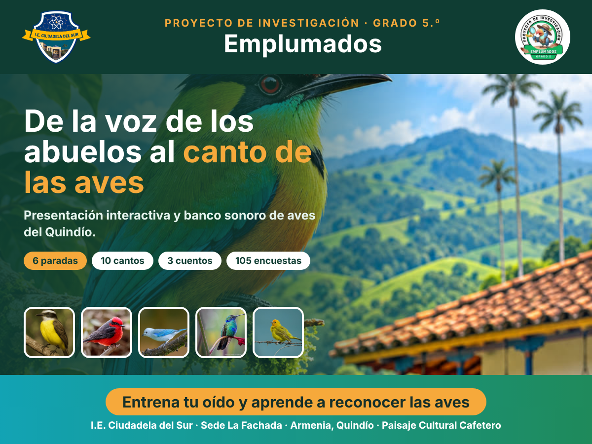

# 🐦 Emplumados · Nuestro camino con las aves

**I.E. Ciudadela del Sur · Sede La Fachada · Armenia, Quindío**
Proyecto de investigación de grado 5.º · Paisaje Cultural Cafetero

> *«Donde hay aves, hay esperanza. Respira, escucha y contempla».*

---

## 🧭 De la voz de los abuelos al canto de las aves

Los estudiantes de grado 5.º investigaron cómo los abuelos del Paisaje Cultural
Cafetero medían el tiempo y el clima escuchando a las aves, y descubrieron que
hoy muchas personas oyen sus cantos pero ya no saben reconocerlos. Este recurso
cuenta todo el proceso en **seis paradas**:

| Parada | Tema | Qué encontrarás |
|:------:|------|-----------------|
| 🔎 1 | **Pensar** | Cuatro habilidades de pensamiento: observar (Alexander Fleming), clasificar (Carlos Linneo), resolver (Ann Makosinski) e inferir (el señor Tábano). |
| 👵 2 | **Abuelos** | Tres cuentos sobre los saberes ancestrales: *El reloj del cafetal*, *El canto que se estaba olvidando* y *Las aves que guardaban secretos*. |
| ❓ 3 | **Preguntas** | Nuestras preguntas problémicas y los resultados de la encuesta a 105 personas. |
| 📰 4 | **Lectura** | Collage con nuestros apuntes sobre la Colombia Bird Fair 2026. |
| 🌱 5 | **Enseñar** | Lo que descubrimos: lo más importante es enseñar a reconocer las aves y hacer pedagogía sobre su importancia. |
| 🎧 6 | **Banco sonoro** | Actividad educativa para aprender a reconocer diez aves por su canto. |

## 🎧 Banco sonoro de aves

Una actividad educativa en dos momentos, con retroalimentación:

- 👂 **Entrena tu oído:** escucha el canto de cada ave las veces que quieras, con su fotografía, su nombre y un dato curioso.
- ✅ **Ponte a prueba:** suena un canto y eliges qué ave es. Al final sabrás cuáles debes repasar.

| Ave | Nombre científico | Así suena |
|-----|-------------------|-----------|
| Barranquero | *Momotus aequatorialis* | «juup… juup» |
| Bichofué | *Pitangus sulphuratus* | «¡bi-cho-fué!» |
| Azulejo | *Thraupis episcopus* | «tsii-tsuii-tsii» |
| Canario criollo | *Sicalis flaveola* | «chip-chip-chiu» |
| Carpintero bellotero | *Melanerpes formicivorus* | «ja-quer, ja-quer» |
| Colibrí chillón | *Colibri coruscans* | «chip, chip, chip…» |
| Golondrina blanquiazul | *Pygochelidon cyanoleuca* | «trrrit, trrrit» |
| Loro cabeciazul | *Pionus menstruus* | «¡quiink, quiink!» |
| Pechirrojo | *Pyrocephalus rubinus* | «pit-pit-pitirrí» |
| Torcaza | *Zenaida auriculata* | «uuu… uuu… uuu» |

## 📊 Lo que nos dijo la encuesta

- **94,3 %** cree que los abuelos escuchaban y prestaban más atención a las aves que las personas de hoy.
- **44,8 %** ha escuchado cantos de aves, pero no sabe cuál es cuál.
- **86,7 %** piensa que los sonidos de la naturaleza generan calma.

## 💻 Cómo usarlo

1. Abre el recurso en el navegador: <https://aguerrerozcisur.github.io/emplumados-aves-quindio/>
2. Avanza con los botones **Anterior** y **Siguiente**, o con las flechas del teclado.
3. Toca las tarjetas, los cuentos y las preguntas para descubrir su contenido.
4. Sube el volumen para el banco sonoro.

Funciona en computador, tablet y celular. Todo el recurso está en un solo archivo: `index.html`.

## 🙌 Créditos

- **Investigadores:** estudiantes de grado 5.º, I.E. Ciudadela del Sur, sede La Fachada.
- **Lectura de apoyo:** «Colombia Bird Fair 2026», El País (Cali), 9 de febrero de 2026.
- **Fotografías de aves:** pertenecen a sus autores; entre ellos, Diego Emerson Torres (humedalesbogota.com), Juza (juzaphoto.com) y farallonesdelcitara.bioexploradores.com.

**Quien las reconoce, las escucha. Quien las escucha, las cuida.** 🌿

